# AsProgrammer dregmod

Read, write and verify SPI, I2C and Microwire flash chips from Windows.
Supports **Buzzpirat, Bus Pirate v3.x, Bus Pirate v5/v6/v7**, CH341a, CH347,
UsbAsp, AVRISP (LUFA), Arduino and FT232H.

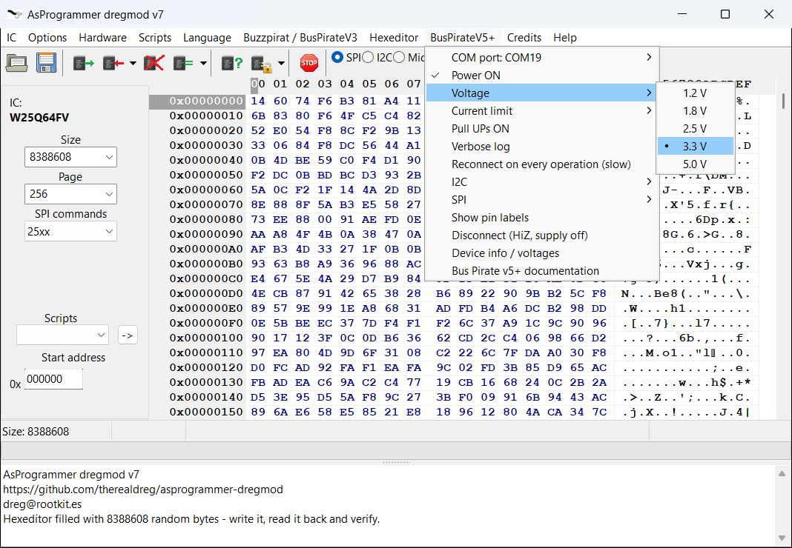

**[Download the latest release](https://github.com/therealdreg/asprogrammer-dregmod/releases/latest)**

The Bus Pirate docs have a step by step guide for the Bus Pirate 5, 6 and 7, with
a screenshot for every step:
<https://docs.buspirate.com/docs/software/asprogrammer-dregmod/>

---

# Before you start

- **Use a short, good quality USB cable, straight into the PC.** USB hubs and
  virtual machines cause problems.
- **Watch the progress bar at the bottom.** It moves while the operation runs,
  and the log pane under it records the start and the result. A big chip at a
  low clock takes a long time, so give it a while before deciding it has hung.
  **Cancel** stays live the whole time.
- **Use the shortest dupont wires you can, 10 cm or less.** This is the single
  biggest cause of bad reads. These are unshielded, unterminated wires carrying a
  clock of several MHz next to each other, and every extra centimeter makes it
  worse. 30 cm jumpers work but leave you no margin. Clip adapters and
  breadboards add length too, so count them in.
- **Long wires and low voltages both push you toward a slower clock.** When a
  read misbehaves, lower the clock first.
- **When something is stuck, reconnect and restart before anything else.**
  Unplug the Bus Pirate from USB, plug it back in, then close the program and
  open it again. Do both: the replug clears whatever state the device is in, and
  restarting drops a serial port the program may still be holding. It costs
  fifteen seconds and it is the fix far more often than anything you would guess
  at instead, so do it before you report a problem too.
- **Do not touch anything while it is working.** That includes the dupont
  wires, the clip, the USB cable, the Bus Pirate itself and the desk it is all
  sitting on. Writing a large chip can take half an hour, and it is tempting to
  tidy up while you wait. A nudge you would not even notice comes back as a
  transfer that stops halfway, a dump that is short, or two reads of the same
  chip that disagree, and every one of those looks exactly like a bug in the
  software. If it happens, reconnect and run it again before concluding
  anything: a fault that does not survive a second attempt was the bench.
- **Get the physical connection right before you blame anything else.** Push the
  clip fully home and check it is on the right way around. Tug each dupont wire
  gently at both ends: the crimp inside the plastic shell is the usual culprit
  and it fails without looking any different. Cheap jumper wires are worth
  replacing rather than debugging. See
  [When the wiring is the problem](#when-the-wiring-is-the-problem).
- **Settings we use in our hardware hacking bootcamps**
  (https://hardwarehacking.es), and a safe place to start if you are not sure:

  | setting | value |
  | --- | --- |
  | SPI clock at 3.3 V or 5 V | 125 kHz |
  | SPI clock at 1.8 V | 30 kHz |
  | I2C clock | 50 kHz |
  | Serial link speed, Bus Pirate v3.x | 115200 baud |

  The table is what just works in a room full of different chips, wires and
  adapters. Get a clean read first, then raise the clock if you care about the
  speed: the program will go up to 8 MHz on a Bus Pirate v3, 16 MHz on a v5 or
  newer, and 2 Mbaud on the v3 serial link. The 30 kHz row is a Bus Pirate v3
  setting. A v5 or newer starts its SPI list at 125 kHz, so for a 1.8 V part
  there use that and keep the wires very short.
- **Wire the chip up before you press anything.** The on board supply is armed
  from the moment the program starts, because **Power ON** is ticked by default.
  It is not live yet: it comes up with the first operation on the chip, such as
  **Read ID** or **Read IC**, or when you run **Scan the I2C bus**. With
  Buzzpirat firmware and **Power ON** ticked, **Device info / voltages** powers
  it up too, but on a v5 or newer it does not. So finish the wiring first, and
  on a Bus Pirate v5 or newer set the **Voltage** before you touch anything,
  because it starts at 3.3 V and a 1.8 V part will not survive that. The program
  keeps the last voltage you used, so check it every time you change chips.
  Unticking **Power ON** does not switch a live supply off at once, only at the
  next operation: use **Disconnect** to switch it off now.

---

# Worked example: reading a 3.3 V SPI flash with a Bus Pirate v6

> **Before anything else, put the latest firmware on the Bus Pirate.** See
> [Firmware: update it, and keep updating it](#firmware-update-it-and-keep-updating-it).

Start to finish on a real part, an SST25VF080B on a breakout board. The same
steps work for any 25 series SPI flash.

The Bus Pirate goes into SPI mode on its own terminal first because that makes
its screen label the pins. AsProgrammer does not need that mode. Wire the chip
up against those labels, and only then switch the device to the binary mode
AsProgrammer speaks. Once the device runs BPIO2 and the program has its port
(steps 4 to 7), **BusPirateV5+ -> Show pin labels** puts the same labels on the
screen with the supply off.

## 1. Open the Bus Pirate terminal

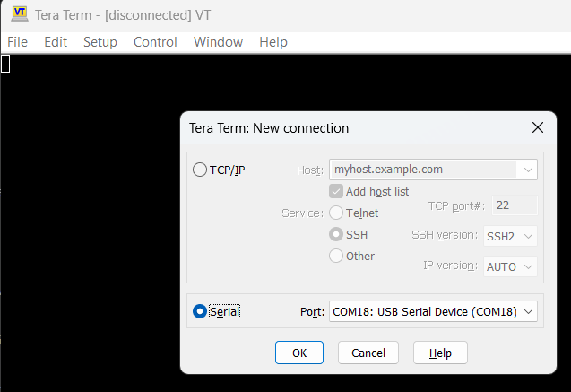

Any terminal program will do. A Bus Pirate v5 or newer shows up as two serial
ports, and this one is its terminal, the one that talks to a human.
AsProgrammer's *BusPirateV5+ -> COM port* menu labels it `terminal`. Here it is
COM18, described by Windows as a USB Serial Device. The baud rate does not
matter.

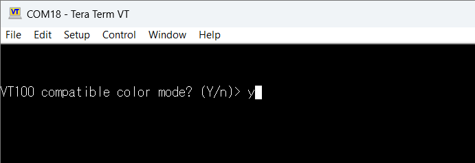

**The window opens black and empty. Press Enter.** That is what makes the device
ask `VT100 compatible color mode? (Y/n)`. Type **y**, press Enter again, and
you are at the Bus Pirate console with its `HiZ>` prompt.

Do not skip this. Until the question is answered the device ignores everything
you type, and a terminal that sits there black is a common way to conclude that
a perfectly healthy Bus Pirate is dead.

## 2. Put it in SPI mode so it labels its pins

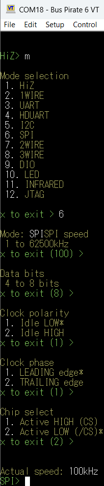

Type `m` for the mode menu and choose **6. SPI**. Then press Enter at each
question to take its default. The answers do not matter: AsProgrammer sets its
own SPI clock and settings. The prompt changes to `SPI>`.

## 3. Read the pinout off the screen and wire it up

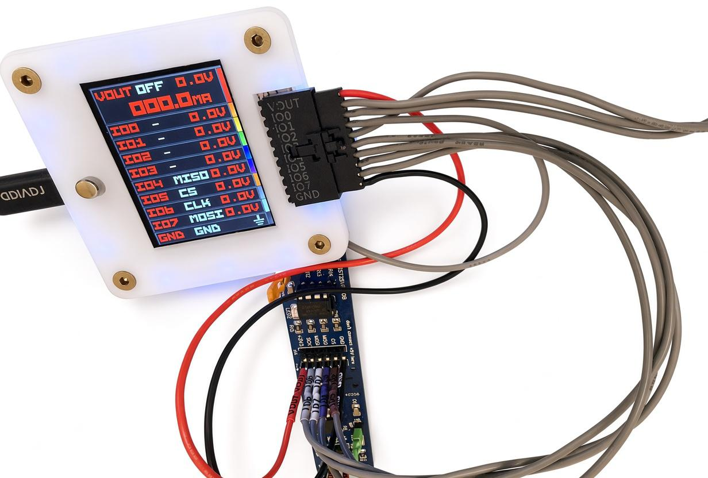

Now the device's own display tells you where everything goes: **IO4 is MISO,
IO5 is CS, IO6 is CLK, IO7 is MOSI**, plus VOUT and GND. The top line reads
`VOUT OFF 0.0V`, which is exactly what you want while you are still connecting
things.

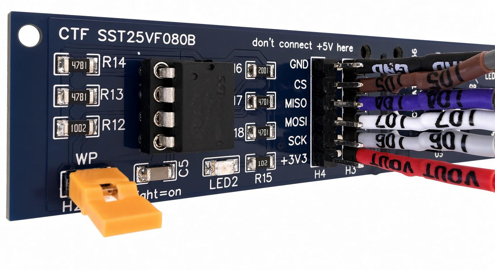

The target header is labeled on the board: GND, CS, MISO, MOSI, SCK, +3V3.
Match them to the Bus Pirate pins, and note two more things printed on the
board. It says **don't connect +5V here**, so the supply has to be 3.3 V,
and the yellow jumper near **WP** is the write protect link. It is fitted in
this photo, which is what you want if you intend to write the chip later.

Wire it with the supply off, and check every connection before you power
anything. See [When the wiring is the problem](#when-the-wiring-is-the-problem)
if anything misbehaves afterwards.

## 4. Switch the device to BPIO2

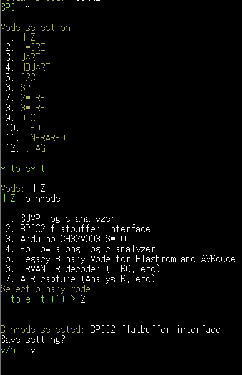

Back at the terminal, `m` then **1. HiZ** to leave SPI mode, then type `binmode`
and choose **2. BPIO2 flatbuffer interface**. Answer **y** to `Save setting?` or
it is forgotten the next time the device restarts.

This is the step AsProgrammer cannot do for you. Out of the box the device's
binary mode is a SUMP logic analyzer, which does not speak BPIO2.

## 5. Select the programmer

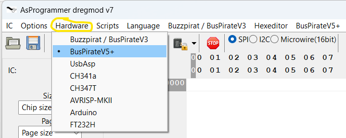

**Hardware -> BusPirateV5+**.

## 6. Select the SPI bus

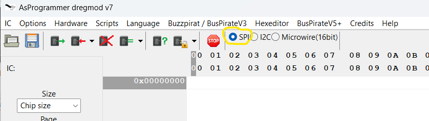

Pick **SPI** with the radio buttons. Do this before choosing the chip, because
changing the bus clears the chip size and page size.

## 7. Pick the right COM port

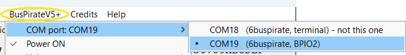

**BusPirateV5+ -> COM port**. The program labels the pair for you: COM18 is the
terminal, marked *not this one*, and **COM19 carries BPIO2**. That is the one to
select: the other port of the pair, not the one the terminal used in step 1.

## 8. Set the bus clock

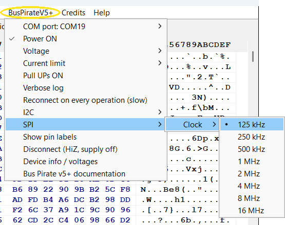

**BusPirateV5+ -> SPI -> Clock -> 125 kHz**. Start slow: at 125 kHz this 1 MB
chip reads in 1:23 (step 13), and it works on wiring that faster clocks do not.
Once you have two identical reads you can raise it.

## 9. Set the supply voltage

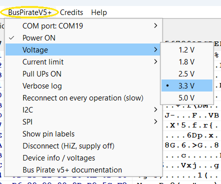

**Voltage -> 3.3 V**, because that is what this part wants and what its board
says. Get this right before the supply comes up: a 1.8 V part on 3.3 V does not
survive it.

## 10. Set the current limit

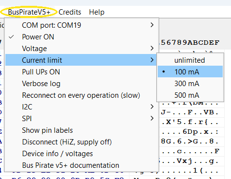

**Current limit -> 100 mA**. A flash chip of this size draws a few milliamps, so
100 mA is generous while still cutting off quickly if something is shorted.

## 11. Check Power ON

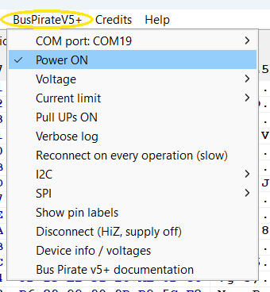

**Power ON** is ticked by default. The supply comes up with the first operation
on the chip, **Read ID** in the next step, so make sure everything is wired
before you go on.

## 12. Identify the chip

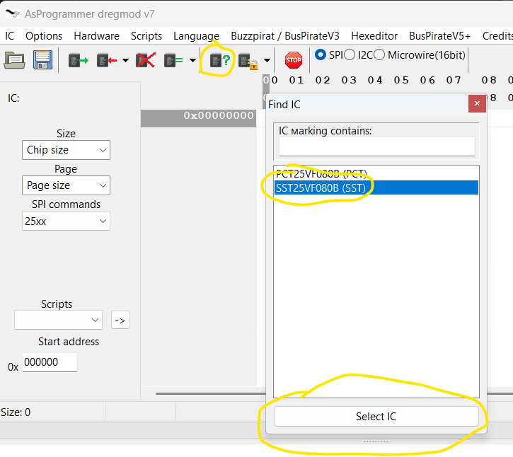

Press **Read ID**. The **Find IC** window opens with the parts that match the
identifier the chip returned. Two entries share this one, `PCT25VF080B (PCT)`
and `SST25VF080B (SST)`, so pick the one that matches the marking on your chip
and press **Select IC**. Nothing is chosen until you do: closing the window
leaves the program with no chip selected.

## 13. Read the chip

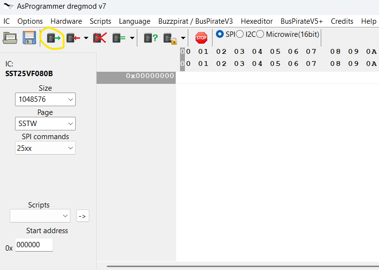

The panel now shows what the chip list knows: **SST25VF080B, size 1048576, page
SSTW**. `SSTW` is not a page size: it marks a family that is written two bytes
at a time instead of by pages. It makes no difference to reading, but it makes
writing much slower. Press **Read IC**.

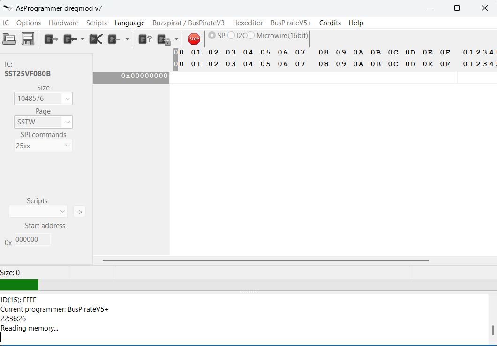

The progress bar at the bottom moves while it works and the log records what is
happening.

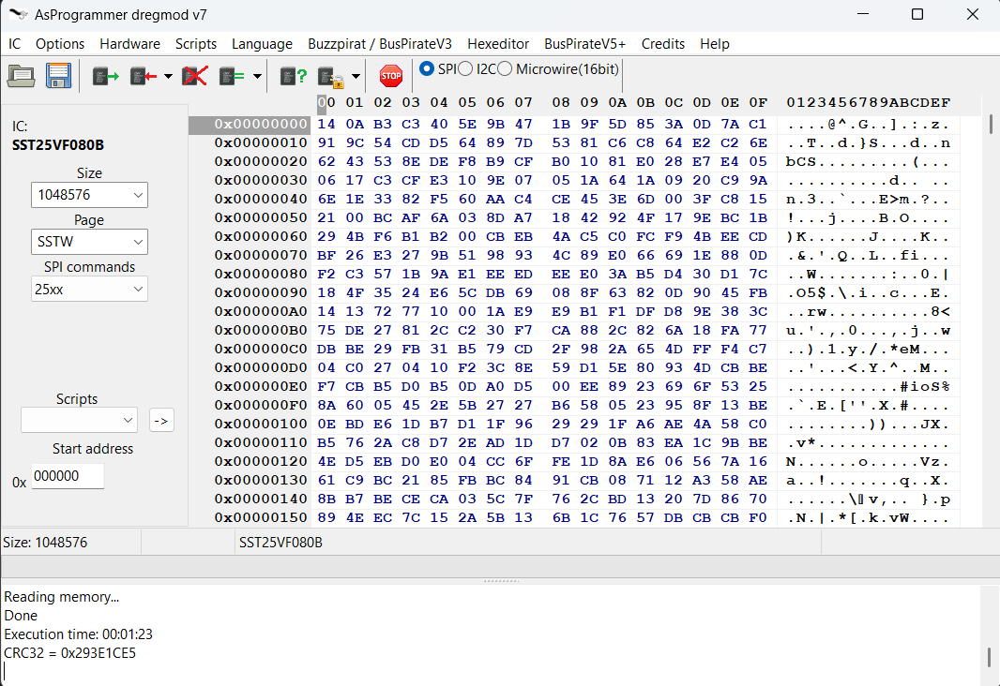

Done. The whole megabyte is in the hex editor, and the log gives the elapsed
time and a CRC32 of what was read, which is a quick way to compare two reads
without saving both. **Press Save file to keep it.** Reading only fills the
editor: nothing reaches your disk until you do.

Then read it a second time and check the CRC32 matches. Two reads that agree are
the cheapest proof you have that the wiring held, and it is worth doing before
you trust the dump or write anything back.

---

# Worked example: reading an I2C EEPROM with a Bus Pirate v6

> **Before anything else, put the latest firmware on the Bus Pirate.** See
> [Firmware: update it, and keep updating it](#firmware-update-it-and-keep-updating-it).

The same walkthrough for an I2C part, an AT24C256 on a breakout board. It
follows the SPI example above, so this one concentrates on what is different:
the device address, the pull ups, and the bus scanner.

## 1. Open the Bus Pirate terminal


The terminal port, the one that talks to a human. COM18 here.


**The window opens black and empty. Press Enter** to make the device ask
**VT100 compatible color mode? (Y/n)**, type **y**, and press Enter again. Now
you are at the Bus Pirate console.

## 2. Put it in I2C mode so it labels its pins

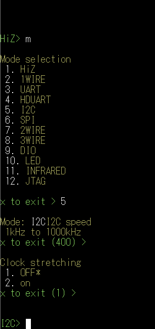

Type `m` and choose **5. I2C**. Take the defaults with Enter: 400 kHz and clock
stretching off. The prompt becomes `I2C>`, and the device display now names its
own pins so you can wire the EEPROM against them.

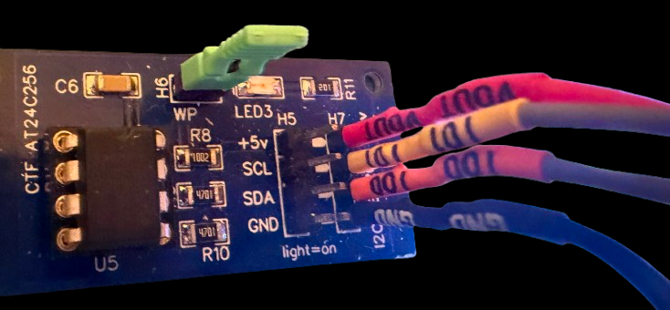

Only four wires, and the board labels every one of them. Reading down the
header:

| board pin | Bus Pirate pin |
| --- | --- |
| +5v | VOUT, the on board supply |
| SCL | IO1, the clock |
| SDA | IO0, the data line |
| GND | GND |

I2C needs only two signals, a clock and a data line, which is why this is so
much simpler than the six wires the SPI example needed. Note the green jumper
fitted at **H6**, next to **WP**: that is the write protect link, and the EEPROM
will refuse to be written without it.

The pin is silkscreened `+5v`, but the screenshots below use 3.3 V. Match the
voltage to your own chip's datasheet rather than to the label.

Wire it up with the supply off, then come back.

## 3. Switch the device to BPIO2

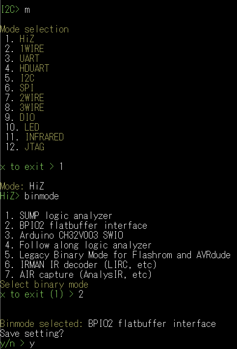

`m` then **1. HiZ** to leave I2C mode, then `binmode` and **2. BPIO2 flatbuffer
interface**. Answer **y** to `Save setting?`.

## 4. Select the programmer


**Hardware -> BusPirateV5+**. Then pick the BPIO2 port under
**BusPirateV5+ -> COM port**, the one the menu labels **BPIO2**, not the
terminal port you used in step 1.

## 5. Select the I2C bus

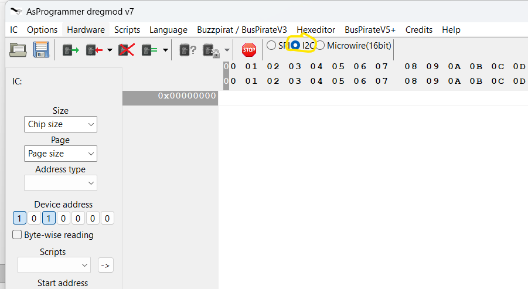

Choose **I2C**. A row of toggles appears reading **1 0 1 0 0 0 0**, which is the
chip's 7 bit address, 0x50. That is the default for a 24 series EEPROM with its
A0, A1 and A2 pins tied to ground, and it is what the scan in step 8 will
confirm.

## 6. Set the supply and the current limit


**Power ON** is already ticked. Set **Current limit** and **Voltage** to suit the
part.

**No pull ups needed here.** The breakout board already has them, which is why
**Pull UPs ON** is left unticked in these screenshots. I2C needs pull up
resistors on SDA and SCL to work at all, and if your board does not carry them
you have to tick that option. A bus with no pull ups at all is the most common
reason a scan finds nothing.

## 7. Set the bus clock

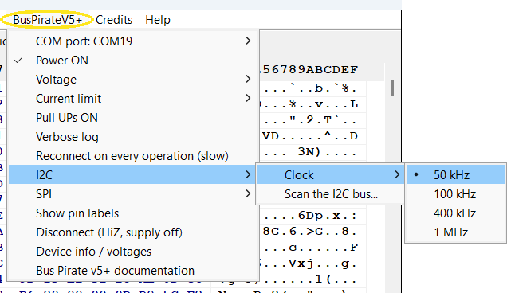

**BusPirateV5+ -> I2C -> Clock -> 50 kHz**. An EEPROM this size reads in seconds
even at the slowest setting, so there is nothing to gain by starting fast.

## 8. Scan the bus

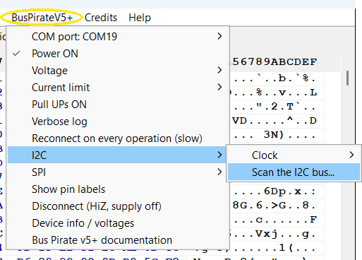

**BusPirateV5+ -> I2C -> Scan the I2C bus...**. Worth doing before anything
else: it shows which addresses answer.

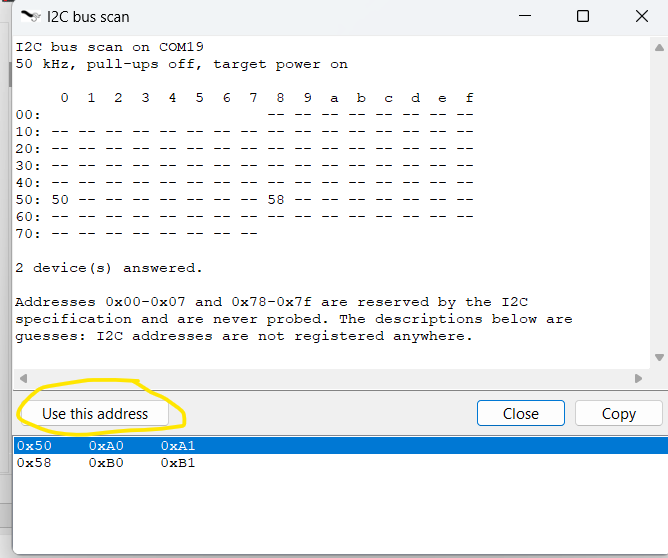

The window reports the conditions it scanned under,
`50 kHz, pull-ups off, target power on`, then an `i2cdetect` style map. Two
addresses answered here:

- 0x50 is the EEPROM itself. The list at the bottom shows its write and read
  addresses, 0xA0 and 0xA1, which are the 7 bit address shifted up with the
  read/write bit added.
- 0x58 also answers on this board. It is not your data.

Select the row you want and press **Use this address** to copy it into the
toggles. The log then says
`I2C device address set to 7-bit 0x50 (write 0xA0, read 0xA1)`. If nothing
answers, the window lists what to check.

## 9. Choose the chip

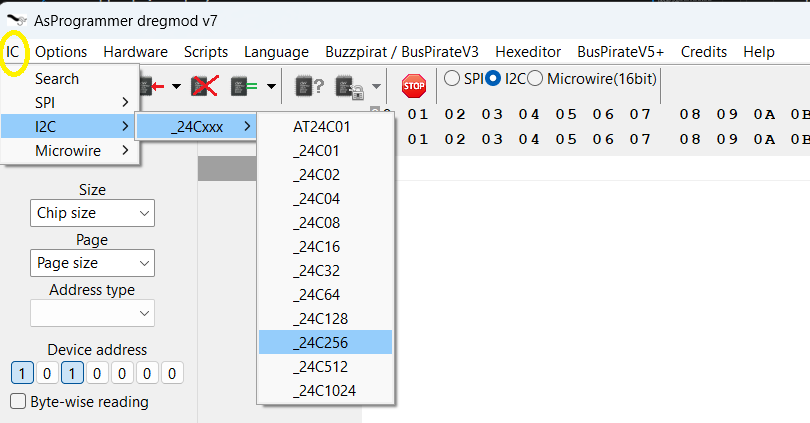

**IC -> I2C -> _24Cxxx -> _24C256**. There is no Read ID on I2C: an EEPROM has
no JEDEC identifier to give, so you have to tell the program what it is. Pick
the entry that matches the marking on your part, because the size and the
addressing width come from that choice and nothing cross checks them.

## 10. Read it

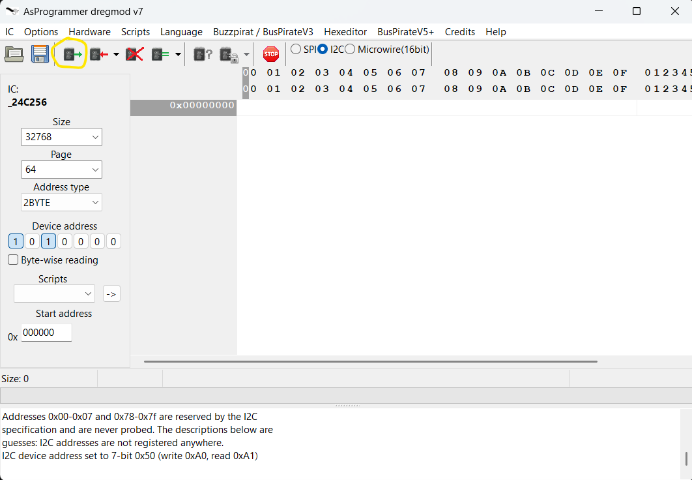

The panel fills in from the chip list: **size 32768, page 64, address type
2BYTE**. That last one matters: EEPROMs from 32 Kbit up take two address bytes
and smaller ones take fewer, and getting it wrong reads the wrong place. Press
**Read IC**.

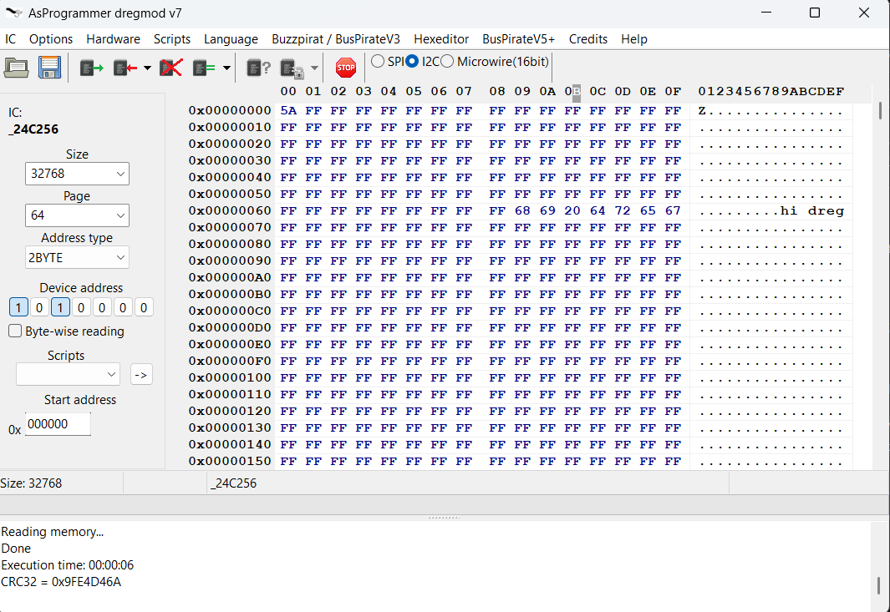

Done in six seconds. The chip is mostly erased, `FF` everywhere, with a short
string written into it earlier, visible as **hi dreg** in the text column at
0x69. The log gives the elapsed time and a CRC32.

**Press Save file to keep it.** Then read it again and check the CRC32 matches.

---

# The shape of every job

The two examples above are Bus Pirate v6 specific. Whatever the programmer, the
job is always the same shape:

1. **Hardware** menu, pick your programmer.
2. On a Bus Pirate, pick the **COM port** in its own menu. The list only shows
   ports that exist right now.
3. Set the supply and the clock. Start slow: 125 kHz for SPI, 50 kHz for I2C.
   On a Bus Pirate v3 there is no voltage setting: the board has fixed 3.3 V
   and 5 V pins, and a 1.8 V part needs an external supply (see the
   [1.8 V example](#spi-flash-winbond-w25q64fw-at-18-v)).
4. Choose the bus with the radio buttons, then the chip. **Read ID** finds it
   for you on SPI; on I2C there is no id to read, so pick it from the **IC**
   menu.
5. **Read IC**, then **Save file**. Reading only fills the hex editor.
6. **Read IC** again and check that the CRC32 in the log is the same. Do this
   before you write anything.

**Read a chip before you ever write one.** It proves the wiring and it leaves
you a backup to put back if a write goes wrong.

---

# What the buttons do

The buttons are icons with no text: hold the pointer over one to see its name.

| button | what it does | changes the chip |
| --- | --- | --- |
| Read ID | asks an SPI flash for its JEDEC id and offers the parts that match. SPI only: an I2C EEPROM has no id to give | no |
| Read IC | reads the whole chip into the hex editor | no |
| Program IC | asks first, then writes what is in the hex editor to the chip | yes |
| Verify IC | reads the chip back and compares it against the hex editor | no |
| Erase IC | asks first, then erases the chip back to all 0xFF | yes |
| Unprotect | clears the write protection bits in the status register | yes |
| Open file / Save file | load or save the hex editor content, nothing is sent to the chip | no |
| Cancel | stops the operation that is running | no |

**Program IC does not erase for you on a 25 series flash, and it does not check
its own work either.** Writing can only turn 1 bits into 0 bits, so programming
on top of data that is already there leaves you with the old and the new ANDed
together. Worse, the write back check, *Options -> Verify*, is off until you
turn it on, so that write finishes and reports Done with nothing wrong in the
log. The habit that saves you is **Erase IC**, then **Program IC**, then
**Verify IC**, every time. I2C EEPROMs are different and overwrite in place, so
they need no erase.

**The small arrow next to a button holds more commands.** Click the arrow
itself: a click on the rest of the button runs the button. Three buttons have
one:

- **Program IC** holds a combined command. It asks once,
  `IC will be erased and programmed. Continue?`, and then runs unprotect, erase,
  program and verify straight through with no further prompts. It stops when
  you press **Cancel** or the erase ends on an error. When an I2C EEPROM
  refuses only some pages, it goes on and programs the pages the chip takes.
- **Verify IC** holds **Blank check**, which compares the chip against all 0xFF,
  on a 25 series flash or an I2C EEPROM from the **Start address** to the end.
  It is the quickest way to prove an erase really took.
- **Unprotect** holds **Set the protection bits**, **Read SREG** and **Edit
  SREG**. *Set the protection bits* writes the status register immediately and
  asks nothing, so it is the one not to press while you are exploring.

**Nothing you do in the hex editor touches the chip.** Open a file, edit it or
fill it with random data: none of it reaches the chip until you press **Program
IC**.

---

# When it does not work

Work down this table before changing anything else. Almost every problem on a
bench is the wiring, the voltage or the clock.

| what you see | what it usually is | what to do |
| --- | --- | --- |
| **Read ID gives 000000 or FFFFFF** | the chip is not really connected: clip on backwards, a pin not making contact, or no power | check pin 1 against the dot on the package, check the supply is on and at the right voltage, reseat the clip |
| **Read ID gives a different answer each time** | the clock is faster than your wiring can carry | drop the SPI clock to 125 kHz |
| **Read ID opens no Find IC window** | no chip in the list has that ID, and the log shows it with `(Unknown)` | 000000 or FFFFFF means the chip did not answer, see the first row. Any other ID is a chip missing from `chiplist.xml`: see [How to add an unsupported chip](#how-to-add-an-unsupported-chip-by-floyd77) |
| **Read IC returns all FF or all 00** | same wiring problem as above, or the chip is held in reset by the board it is still soldered into | fix the read first, do not write anything yet |
| **Two reads of the same chip differ** | long wires, a weak supply, or too fast a clock | shorten the wires, lower the clock, and only trust the chip once two reads agree |
| **It stopped halfway, or the dump is short** | something moved: a wire, the clip, or the USB cable | reconnect and run it again. This is worth ruling out before anything else, because it costs one minute and it looks identical to a software fault |
| **Short operations work, long ones do not** | a wire or a crimp that is barely making contact | reseat the clip and check the crimps on the dupont wires. See [When the wiring is the problem](#when-the-wiring-is-the-problem) |
| **The I2C scan finds nothing** | the pull ups are off, a wire is wrong, or the chip has no power | the scan window lists what to check on the Bus Pirate it ran on. If the board has no pull ups, tick **Pull UPs ON** and scan again. On a Bus Pirate v3 the pull ups are fed from the **VPU** pin, so ticking the menu does nothing unless VPU is wired to 3.3 V or 5 V |
| **The log says `IC not responding`** | nothing acknowledged the I2C device address, which every I2C operation checks first | check the pull ups, the VPU pin on a Bus Pirate v3, the clock, and that the address toggles match how A0, A1 and A2 are strapped |
| **Program IC finishes but Verify IC fails** | the chip was not erased first, or it is write protected | press **Erase IC**, then **Program IC** again. If it still fails press **Unprotect** and repeat |
| **An SST chip refuses to be written at all** | SST 25 series parts power up with their blocks protected, unlike most others | press **Unprotect** once after powering the chip. Nothing is wrong with it, that is the family's default |
| **Writing or erasing an I2C EEPROM changes nothing, or the log says pages failed** | the write protect pin is tied high, or the chip protects part of itself (an SPD EEPROM can protect 00h-7Fh) | tie WP to ground. A protected area stays as it is, and the program still writes the rest of the chip |
| **The size or the page size looks wrong** | the part chosen from the list is not the one on the clip | check the marking on the package and pick that part |
| **The log says the link is out of sync** | a reply came back late or short, usually a cable or clock problem, or the Bus Pirate was unplugged and plugged back in | the program re-arms the link by itself when the next operation starts, and after a replug it opens the port again in the same operation. If it keeps happening, lower the clock, and on a Bus Pirate v3 the serial link speed |
| **The COM port will not open** | another program still holds it | close any terminal you left open on that port |
| **It is stuck, or nothing responds any more** | the device is in a state neither it nor the program can get out of | unplug the Bus Pirate from USB, plug it back in, then close AsProgrammer and open it again. Do both, in that order |
| **The log says the target may still be powered** | the program could not put a Bus Pirate v5 or newer in HiZ | unplug the Bus Pirate from USB |
| **The log says `Power supply initialization failed`** | a Bus Pirate v5 or newer could not switch its supply on: the current limit tripped while it came up, or the target has power of its own feeding back into VOUT | look for a short, power the target from one place only, and raise **Current limit** only if the chip needs more |
| **The log says the current limit tripped and the Bus Pirate cut the target supply** | the target drew more than **Current limit**, usually a short or a wrong pin | the operation fails when the trip is found as it starts; when the trip comes during the operation, the log adds at its end that its result cannot be trusted. Fix the wiring, then run it again: that switches the supply back on |
| **The log says the target supply was switched off, switched on or set outside this program** | someone changed the supply on the Bus Pirate's terminal while this program held the device | leave the terminal alone while AsProgrammer works. The supply is switched off, the operation fails or is marked as not to be trusted, and the next one applies the menu settings again |
| **The log says the target supply measures under 90 % of the voltage set** | a short or a heavy load is dragging the supply down | the supply is switched off. Check the wiring and the chip before you run anything again |
| **You picked the chip but the size is still wrong** | Read ID only fills the **Find IC** list and does not choose for you | double click the part in that window, or press **Select IC** |
| **The dump is shorter than the chip** | the **Start address** field is left over from an earlier operation, and a read runs from there to the end | clear it back to 0 |
| **You read a 32 MB chip and got 16 MB** | the read length comes from the **Chip size** box, not from the chip | set the real size. The program also picks three or four byte addressing from that number, so a size of 16 MB or less on a bigger chip quietly reads only the bottom of it |
| **Your chip settings emptied themselves** | clicking the **SPI**, **I2C** or **Microwire(16bit)** radio resets **Chip size** and **Page size** | choose the bus first, the chip second |
| **The window is frozen** | it is working | wait, and watch the progress bar |

## When the wiring is the problem

Nearly every reproducible fault on a bench turns out to be the wiring, and the
symptoms look just like a software bug.

**The signature of a bad contact is that short operations always work and long
ones do not.** Read ID and the status register move a handful of bytes and go
through every time, so the chip looks healthy. Then a full read dies part way,
at a *different place on each attempt*. A protocol or software fault is
repeatable: it fails the same way at the same point.

Other shapes of the same thing:

- Two reads of the same chip that do not agree with each other.
- A read that starts with the right bytes and then turns into `FF` for the rest.
- A write that reports Done while the chip keeps its old contents.
- An operation that ran fine yesterday and fails today with nothing changed.

**What to do, in this order.** Switch the supply off with **Disconnect** before
you touch the wiring. Each step costs a minute and rules out more than guessing
does:

1. Reseat the clip, fully home, and check pin 1 against the dot on the package.
2. Tug each dupont wire gently at both ends. A crimp that has worked loose
   inside the shell looks exactly like a good wire. Squeezing a loose one with
   pliers has fixed this outright.
3. Unplug the Bus Pirate from USB, plug it in again, then close the program and
   open it again.
4. Shorten the wires. 10 cm is a different world from 30 cm.
5. Lower the SPI or I2C clock, and if you raised the Bus Pirate v3 link speed,
   put it back to 115200.

Only when all of that is clean is it worth suspecting the chip or the software.

**A note on what this program will and will not do about it.** On a 25 series
flash and an I2C EEPROM, a chunk that comes back short stops the read, and the
log names its address. A verify stops at the first byte that differs and names
its address. The program cannot tell a bad wire from a bad chip: the log gives
the symptom, and the steps above find the cause.

---

## Mistakes that cost you a chip

- **Check the voltage before you power anything.** A 1.8 V part on the 3.3 V
  setting is destroyed, and nothing in software will save it.
- **Do not leave WP and HOLD floating** on a 25 series flash. Tie them to VCC.
  Floating pins give you reads that change from one attempt to the next.
- **A chip still soldered into a powered board will not read properly.** The
  board's own supply and whatever else is on the bus fight the programmer. Take
  the board's power away, and if that is not enough, desolder the chip.
- **Keep the backup you saved before the write.** It is the only way back from a
  bad write.
- **Do not trust a write you did not verify.** Press **Verify IC** after
  **Program IC**, or turn on *Options -> Verify*, which is off by default.
- **A part chosen by name is never cross checked against the chip.** The size
  and the page size come from the list entry you clicked, and nothing compares
  them with what the chip reports. The wrong entry writes to the wrong
  addresses.

---

# Bus Pirate v5 and newer

Bus Pirate v5, v6 and v7 speak a different protocol from the v3.x, so they have
their own **BusPirateV5+** menu. Everything else in the program works the same.
The Bus Pirate docs have this setup step by step:
<https://docs.buspirate.com/docs/software/asprogrammer-dregmod/>.

## Firmware: update it, and keep updating it

**Install the latest firmware before you do anything else, and do it again from
time to time.** The binary interface this program speaks is part of what is
being worked on. An old build can be missing a fix, or answer differently from
what the current documentation describes, and you will spend your afternoon
debugging your wiring instead.

The project says the same: its firmware page opens with *"Don't skip this step!
We're adding features and squashing bugs daily."*

- Instructions: <https://docs.buspirate.com/docs/tutorial-basics/firmware-update/>,
  listed in the sidebar as Upgrade Firmware.
- The download is an automatic build, published every time the code changes:
  <https://forum.buspirate.com/t/bus-pirate-5-auto-build-main-branch/20/999999>.
  Take the `.uf2` that matches your board, for example `bus_pirate5_rev10.uf2`
  or `bus_pirate6_rev2.uf2`. Do not wait for a tagged release: there is not
  really one to wait for.

If something in this program misbehaves with a v5 or newer, update the firmware
first and try again before reporting it.

## You have to put the device in BPIO2 mode yourself

A Bus Pirate v5 or newer can run several different binary protocols and only
speaks the one it has been told to. Out of the box that is the SUMP logic
analyzer, not the one AsProgrammer needs, and nothing will work until you change
it. On the device's terminal port: `binmode`, then **2. BPIO2 flatbuffer
interface**, then **y** to `Save setting?` or it is forgotten on the next
restart. Typing `i` afterwards should report
`Active binmode: BPIO2 flatbuffer interface`. PulseView, flashrom and AVRDUDE
use other binmodes: select theirs again with `binmode` when you go back to
them.

Both worked examples above show this on screen, in step 4 of the SPI one and
step 3 of the I2C one.

With SUMP still active, AsProgrammer reports within a few seconds that no BPIO2
answer came, and leaves the device alone. The bytes it sent wait in the device,
though, and a program that later opens the port AsProgrammer used, while SUMP
is still active, can hang the Bus Pirate: red LEDs, and a terminal that does
not answer. Unplug it and plug it back in before you use SUMP again.

## Then pick the right COM port

The device shows up as **two** serial ports. One is the terminal you just used,
the other carries BPIO2, and that second one is what AsProgrammer needs. Open
**BusPirateV5+ -> COM port**: the program labels the pair for you, so pick the
one marked **BPIO2** and not the one marked *not this one*. If your ports are
not labelled, which happens on some machines, try one and then the other, or
look in Device Manager: the BPIO2 port's Hardware Ids end in `MI_02`, the
terminal's in `MI_00`. A wrong port gives the same `no BPIO2 answer on` line in
the log as a device that is not in BPIO2 mode, so check both.

## The rest of the menu

| item | what it does |
| --- | --- |
| COM port | which serial port to talk to, as described above |
| Power ON | the on board supply that powers your chip. Ticked by default. The supply comes up with the next operation on the chip, or with an I2C scan, and stays on between operations; a new Voltage or Current limit switches it off and on again |
| Voltage | 1.2, 1.8, 2.5, 3.3 or 5.0 V for the supply. **Starts at 3.3 V**, then at the last value you used, so check it before you power a 1.2 V or 1.8 V part |
| Current limit | unlimited, 100 mA, 300 mA or 500 mA: how much the supply will give before it trips. Starts at 300 mA |
| Pull UPs ON | on board pull up resistors, needed for I2C. Off by default |
| Verbose log | extra detail in the log pane, useful when something is wrong |
| Reconnect on every operation (slow) | off by default and best left off: it parks the device after every operation, which switches the target supply off between them |
| I2C -> Clock | 50 kHz, 100 kHz, 400 kHz or 1 MHz. Starts at 50 kHz. On a Bus Pirate 5 REV10 a 24C256 module did not answer at 1 MHz, though a Bus Pirate 6 reads it at 1 MHz: use 400 kHz there |
| I2C -> Scan the I2C bus... | find out what is on the bus |
| SPI -> Clock | 125 kHz, 250 kHz, 500 kHz, 1, 2, 4, 8 or 16 MHz. Starts at 125 kHz |
| Show pin labels | the Bus Pirate's screen labels the pins of the bus picked in the window, SPI or I2C, so you can see where each wire goes. It turns the supply and the pull ups off, so the Bus Pirate powers nothing while you wire; the next operation sets them as the menu says |
| Disconnect (HiZ, supply off) | puts the pins in high impedance, turns the supply and the pull ups off, and closes the COM port. If the log says the target may still be powered, unplug the Bus Pirate. Closing the program parks the device the same way, and asks you to unplug it when that fails |
| Device info / voltages | hardware version, firmware date and hash, mode, and the supply as set and as measured. It never turns the supply on, and once an operation has set the supply it switches it off when it finds a fault |
| Bus Pirate v5+ documentation | opens the Bus Pirate docs page about this program in your browser |

## If BPIO2 will not work for you, there is a legacy mode

A Bus Pirate v5 or newer can also pretend to be a Bus Pirate v3, and this
program will drive it that way. **Try BPIO2 first.** It is the native protocol
of your hardware. Speed is no reason to avoid the legacy mode: on a Bus Pirate 6
at 1 MHz a 64 Mbit read took 111 seconds over BPIO2 and 98 over the legacy mode,
and the legacy mode wrote a whole SST25VF080B in about a third of the time.
Reach for legacy if BPIO2 is giving you trouble, or if you want the same setup
you use with flashrom.

1. Open the Bus Pirate's terminal port, type `binmode`, and pick
   **5. Legacy Binary Mode for Flashrom and AVRdude**. This binmode is not
   saved, so select it again after the Bus Pirate restarts. It asks its own
   questions: the HOLD and WP pins, a clock on IO0 (answer **n**), then the
   supply voltage and the current limit.
2. In AsProgrammer choose **Hardware -> Buzzpirat / BusPirateV3**.
3. Under *Buzzpirat / BusPirateV3 -> COM port*, pick the **same** port BPIO2
   would use, the one *BusPirateV5+ -> COM port* labels **BPIO2**. Legacy mode
   runs on that same port, not on the terminal. Do not go by the COM numbers:
   the pairing comes from the USB interface, so the one you want is not always
   the higher number.

From there it behaves like a Bus Pirate v3 for SPI, and the
[Buzzpirat / Bus Pirate v3](#buzzpirat--bus-pirate-v3) section applies. The
legacy mode only speaks SPI, so the program refuses I2C there: use BPIO2 for an
I2C chip.

**It stays at 115200 baud, and that costs nothing.** In this mode the device
introduces itself as hardware v2.5. The program will not raise the link speed on
anything below v3.0, so the *Serial link speed* menu does nothing here. The link
is USB anyway: the legacy read above moved 86 kB/s, more than seven times what
115200 baud carries.

**Disconnect leaves it in legacy mode.** A Bus Pirate v3 reboots into its
terminal; the legacy mode answers with a greeting and keeps running until the
Bus Pirate restarts, and the log says so.

## Things worth knowing

**Microwire does not work on any Bus Pirate here.** Neither driver implements
it, so a v3.x is no help either. For a Microwire part use one of the other
programmers this software supports: CH341a, CH347T, UsbAsp, AVRISP-MKII,
Arduino or FT232H.

---

# Buzzpirat / Bus Pirate v3

## Firmware

**Use the latest Buzzpirat firmware:** https://buzzpirat.com/docs/firmware-update/

On a Bus Pirate v3, take the build that page offers for the Bus Pirate v3
hardware. The program reads the firmware version when it connects, and the log
says what that firmware cannot do. It refuses SPI on firmware older than 5.5.
Community builds from 2019 to July 2025, and Buzzpirat firmware before v7.1.9,
never acknowledge an SPI write that reads nothing back, so on them the program
can read a chip of up to 16 MB but refuses write enable, erase and program.

## Buzzpirat menu

| item | meaning |
| --- | --- |
| COM port | live list of the serial ports the machine has right now, refreshed while the program runs. The choice is remembered in `settings.xml` |
| Serial link speed | 115200 baud, 230400, 250000, 1 Mbaud or 2 Mbaud. Starts at 115200, which always works. A device below hardware v3.0 or firmware 5.5 is held there whatever you pick, and the log says why |
| Pull UPs ON | on board pull ups, needed for I2C. They are fed from the VPU pin, so wire VPU to the chip's supply. Off by default |
| Power ON | the 3.3 V and 5 V rails. Ticked by default, and they come up with the next operation on the chip, or with an I2C scan |
| Verbose log | extra protocol chatter in the log pane |
| Reset device on every operation (slow) | off by default. The link stays open between operations, which makes reads and writes fast. Tick it only when you want the device back at its terminal after every operation |
| I2C -> Clock | 5 KHz, 50 KHz, 100 KHz or 400 KHz (not recommended). Starts at 50 KHz |
| I2C -> Scan the I2C bus... | probes 0x08..0x77 and shows an `i2cdetect` style map of what answered, with a guess at each part and a button that copies an address straight into the I2C address toggles. It runs on demand from any state, whatever the SPI/I2C radio says |
| SPI -> Output Normal (H=3.3V) / Output Open drain (H=Hi-Z) (buzzif check) | SPI pin drive: push pull 3.3 V, or open drain with the high level set by the pull ups, which is what a 1.8 V part needs. Pull UPs ON makes the pins open drain too |
| SPI -> Clock | 30 KHz (1v8), 125 KHz, 250 KHz, 1 MHz, 2 MHz, 2.6 MHz, 4 MHz or 8 MHz. Starts at 125 KHz. When the program cannot tell which clock table the firmware uses (community v7.0, or a version banner it could not read), the clocks above 1 MHz run at 1 MHz. On firmware 6.1 and older the clocks above 2 MHz run at 2 MHz. The log says so when the program connects |
| Disconnect and reset device | closes the port and puts the device back at its user terminal |
| Device info / voltages | hardware and firmware version and link speed. On Buzzpirat firmware also all rail voltages and, with Power ON ticked, a power supply short check, which powers the target |

## Hexeditor menu

In the hex editor, **Ctrl+F** finds a byte sequence and **Ctrl+R** fills the
buffer with random data.

**Fill with random data** (also on the right click menu of the hex editor)
replaces the whole hex editor content with random bytes. It is there for round
trip testing: fill, **Erase IC**, **Program IC**, then **Verify IC**. Every run
produces different data, so stale content or a chip that ignores writes cannot
pass by accident.

---

# Buzzpirat / Bus Pirate v3 examples

> **Before anything else, put the latest Buzzpirat firmware on the device.**
> Some Community Firmware builds have a bug in the binary SPI mode that this
> program depends on. See [Firmware](#firmware).

The screenshots in these three examples come from an older version, with other
menu names and items. The steps use the names the program shows.

## I2C EEPROM: Microchip AT24C256 at 5 V

### 1. Connect Buzzpirat to at24c256 chip

Connect the Buzzpirat's +5V to both VCC and VPU, MOSI to SDA, CLK to SCL and
GND to GND.


(THX TO David Sanchez & Mecanico for images)

### 2. Buzzpirat / BusPirateV3 -> COM port, and turn Pull UPs ON

Pick **Hardware -> Buzzpirat / BusPirateV3** first. The COM port menu lists the
serial ports the PC has right now, by name only. If you are not sure which one
is the Buzzpirat, unplug it and see which one goes.


### 3. IC menu -> I2C -> _24Cxxx -> _24C256


Choosing the part does **not** set its bus address. That comes from the
**Device address** toggles, which start at 1010 000, or 0x50. That is the
address an AT24C256 uses with A0, A1 and A2 tied to ground, which is how the
wiring above has it, so this example works without touching them. If your part
has any of those pins tied high, its address is different and nothing will
answer until you set the toggles to match. The I2C scan in step 4 will tell you
which address it is really on.

### 4. Optional: Buzzpirat / BusPirateV3 -> I2C -> Scan the I2C bus...


Do it before you read. If nothing answers, the scan window lists what to check:
the wiring, the pull ups and VPU, the supply and the clock. An EEPROM that
answers at 0x51 to 0x57 instead of 0x50 has some of its address pins tied high:
select its row and press **Use this address** to copy it into the toggles.

### 5. Press "Read IC" and wait


### 6. Press "Save file" and keep the dump

Reading only fills the hex editor. Nothing reaches your disk until you press
**Save file**. Do this before you write anything to the chip.

---

## SPI flash: Winbond W25Q64 at 3.3 V

### 1. Connect Buzzpirat to the Winbond chip

Connect the Buzzpirat's +3V3 to VCC, MISO to DO and MOSI to DI. CS, CLK and
GND go to the pins of the same name.


(THX TO David Sanchez & Mecanico for images)

### 2. Select the SPI radio button


Pick **Hardware -> Buzzpirat / BusPirateV3** and its COM port first, and leave
**Pull UPs ON** unticked: it makes the SPI pins open drain. SPI is already
selected when the program starts, so usually there is nothing to
do here. It matters because **Read ID** and **Unprotect** only work on SPI and
are greyed out otherwise. Clicking a bus radio clears the **Chip size** and
**Page size** boxes, so do this before you choose the chip.

### 3. Press "Read ID", then select W25Q64BV


The **Find IC** window lists the parts that match the ID the chip returned.
Double click `W25Q64BV`, or highlight it and press **Select IC**. Until you do,
the program has no chip size, and **Read IC** stops with `Check settings`.

If no window opens, the log shows the ID followed by `(Unknown)`: see
[When it does not work](#when-it-does-not-work).

### 4. Press "Read IC" and wait

At the default 125 kHz and 115200 baud this takes about 23 minutes, and with
the SPI clock raised to 8 MHz about 13. At 125 kHz, 2 Mbaud under
*Buzzpirat / BusPirateV3 -> Serial link speed* halves the time, so raise both
if you are reading something this size.

Start the link at 115200, which works on any cable and any board, and prove the
chip reads correctly. Once two reads agree, raise it to 2 Mbaud, and drop back
if a read then goes wrong. The link speed is the serial line to the Bus Pirate,
a separate setting from the SPI clock on the chip.

Then press **Save file** to keep the dump.

**Writing takes far longer than reading, and that is normal.** On a Bus Pirate
v3 at 125 kHz and 2 Mbaud a page took 64 ms, so writing this chip takes about
35 minutes. Reading streams; writing goes one 256 byte page at a time, and
after every page the programmer has to ask the chip whether it has finished. At
32768 pages, that round trip is what you wait for.

**Some chips are slower still, and there the programmer does matter.** Most SST
25 series parts have no page program command. The program writes them one byte
at a time (`SSTB` in the page column of the chip list) or two (`SSTW`), and
each of those costs a full round trip to the device. A whole SST25VF080B (1 MB,
`SSTW`) took about 4 hours 40 minutes to write on a Bus Pirate v3 at 125 kHz and
115200 baud. A Bus Pirate 6 at 1 MHz took about 15 minutes over BPIO2 and 5
minutes over its legacy binary mode.

The chip takes the same time with every programmer. What differs is the round
trip: a v5 or newer talks over its own USB interface, while a v3 goes through an
FTDI serial adapter whose driver adds a latency delay to every exchange. A
Winbond pays that delay for every 256 bytes, an `SSTW` part for every two.

So if you have both, write SST parts with the v5 or newer. For reading, or for
any chip with a real page program command, either is fine.

---

## SPI flash: Winbond W25Q64FW at 1.8 V

> **Do not connect the Buzzpirat's +3V3 or +5V to this chip.** It runs at
> 1.8 V.

Follow the same steps as the 3.3 V Winbond above, but connect the Winbond's VCC
and the Bus Pirate's VPU to an external 1.8 V supply, with all the grounds tied
together:


Change the following in the configuration, all of it under the
*Buzzpirat / BusPirateV3* menu:

- **Pull UPs ON**
- **SPI -> Output Open drain (H=Hi-Z) (buzzif check)**
- **SPI -> Clock -> 30 KHz (1v8)**


In the **Find IC** window select `W25Q64FW_1.8V`. In the chip list, `_1.8V` at
the end of a name marks a 1.8 V part.


Press "Read IC" and wait. At 30 kHz and 115200 baud this takes nearly an hour.


---

# How to add an unsupported chip, by Floyd77

Search for your unsupported chip here (Ctrl+F searches the page):

https://chromium.googlesource.com/chromiumos/third_party/flashrom/+/798d2adc9527f724bc5096a646cf99efdbb6b59e/flashchips.h

I'll take W25Q256JW as example. You'll see this on that list:

```c
#define WINBOND_NEX_W25Q256_W	0x6019	/* W25Q256JW */
```

Open chiplist.xml in the AsProgrammer folder. I use Notepad++ to edit the file.
Search for the brand in it, `<WINBOND>` in this case, and add a new line to
that list. For this example the line is:

```xml
<W25Q256JW_1.8V id="EF6019" page="256" size="33554432"/>
```

Save the file and start AsProgrammer again: it reads the chip list when it
starts. The chip then appears in the **IC** menu and in **IC -> Search**, and
**Read ID** finds it when you connect it to the programmer.

Notes:

When the chip uses 1.8V you add "_1.8V" after the model name.

The id starts with the maker's ID, which differs for each brand: for Winbond it
is EF, `WINBOND_NEX_ID` in the same flashchips.h. The number from the list
follows it: 0x6019 gives "EF6019".

Page and size are easy to fill if you compare the data with another similar
chip in the list. In this example every Winbond chip has a page value of 256.
For the size, take the capacity in megabits from the part number (256), divide
by 8 to get mebibytes (32), then convert that to bytes (33554432).

Converter:

https://convertlive.com/u/convert/mebibytes/to/bytes#32

---

# Reporting problems

Only issues and PRs about the Buzzpirat and Bus Pirate support are accepted.
Report a problem on the
[issues page](https://github.com/therealdreg/asprogrammer-dregmod/issues), with
the log of a run with **Verbose log** ticked. For anything else, check whether
the same problem happens with the official UsbAsp-flash and report it there:

- https://github.com/nofeletru/UsbAsp-flash/issues
- https://github.com/nofeletru/UsbAsp-flash/discussions

---

# How to build & debug

Instructions tested for Windows 11.

> **Use a Release build, run outside the Lazarus IDE, to work on a chip.** The
> Debug build mode turns on range and overflow checks, and reading a chip with
> it can stop on an exception.

> **Edit the .lfm files by hand, not in the Lazarus form designer.** A caption
> that changes in main.lfm, by hand or through the IDE, breaks its translations
> unless the `.po` files in `software/lang` change with it.

## 1. download & Install lazarus 32 bits

https://www.lazarus-ide.org/

Lazarus 4.8 with FPC 3.2.2 builds the program. Take the Windows 32 Bits
installer: the program and the DLLs it loads are 32 bit.


## 2. clone this repo

```
git clone https://github.com/therealdreg/asprogrammer-dregmod.git
```

## 3. extract mphexeditor.zip to root project folder


## 4. Copy chiplist.xml to software/ directory

Copy `CH341DLL.DLL`, `CH347DLL.DLL`, `ftd2xx.dll` and `libusb0.dll` there too,
from the [release zip](https://github.com/therealdreg/asprogrammer-dregmod/releases/latest):
the program needs them to start.

## 5. Open AsProgrammer.lpi with lazarus

It is in `software/`. Ignore the errors and warnings about the hex editor: the
next step installs it.

## 6. Install mphexeditor

Go to **Package -> Open Package File (.lpk) ...**


Select file:

`asprogrammer-dregmod\mphexeditor\src\mphexeditorlaz.lpk`

In the package window, **Use -> Install**


Lazarus asks **Rebuild Lazarus?**: answer **Yes** and wait for it to rebuild
and restart.

## 7. Change build mode to debug


## 8. Press F9 key to run & select Enable Dwarf 3

When Lazarus asks you to **Choose Debug Information format**, pick **Enable
Dwarf 3 (-gw3)**.

## 9. How to rebuild all (ex: after a Menu Form change)

**Run -> Clean up and Build ...**, then press **Clean up and build** in the
window that opens.


## 10. The Bus Pirate drivers

The Buzzpirat and Bus Pirate v3 driver is `software/buzzpirathw.pas`, and the
Bus Pirate v5+ one is `software/buspirate5hw.pas`, both built with the rest of
the program. Tick **Verbose log** in their menus to see the protocol steps in
the log pane, and set a breakpoint in either unit to debug it. The protocol
references: <http://buzzpirat.com/docs/binaryio/> for the v3, and
<https://docs.buspirate.com/docs/binmode-reference/protocol-bpio2/> for BPIO2.

---

# Credits

- nofeletru for AsProgrammer: https://github.com/nofeletru/UsbAsp-flash
- Ian Lesnet (Bus Pirate Creator): https://buspirate.com/

---

# Related

- https://docs.buspirate.com/docs/software/asprogrammer-dregmod/
- https://github.com/therealdreg/flashrom_build_windows_x64
- https://github.com/therealdreg/buzzpirat
